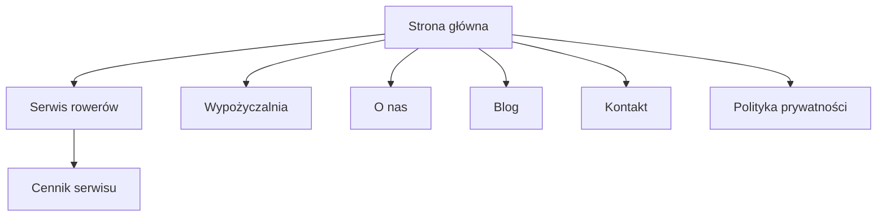

# Karta MP1: firma, persony, mapa strony

## 1. Firma (fikcyjna)

**Nazwa:** Pedał & Co. – serwis i wypożyczalnia rowerów w Poznaniu

**Oferta:**
- serwis rowerów miejskich, trekkingowych i elektrycznych (przeglądy, naprawy, regulacje),
- wypożyczalnia rowerów miejskich i e-bike'ów (na godziny, dni i weekendy),
- krótkie porady serwisowe i trasy rowerowe po Wielkopolsce (blog).

**Grupa docelowa:** mieszkańcy Poznania dojeżdżający rowerem do pracy lub na uczelnię (25–45 lat) oraz turyści i osoby wypoczywające weekendowo, które chcą szybko wypożyczyć rower.

**Cel strony:** zwiększyć liczbę zapisów na serwis i rezerwacji rowerów online oraz poprawić widoczność w lokalnych wynikach wyszukiwania.

## 2. Persony

### Persona 1: Marta, 32 lata, pracuje w biurze

| Element | Opis |
|---|---|
| **Cel** | Mieć sprawny rower do codziennych dojazdów i nie tracić czasu na wizyty w serwisie |
| **Problem** | Nie wie, ile kosztuje naprawa i jak długo rower będzie w serwisie; dzwonienie w godzinach pracy jej nie pasuje |
| **Urządzenie** | Smartfon (w tramwaju lub w przerwie w pracy), czasem laptop |
| **Oczekiwana akcja (CTA)** | „Umów serwis” – formularz z wyborem terminu i rodzaju usługi |

### Persona 2: Tomasz, 41 lat, turysta weekendowy

| Element | Opis |
|---|---|
| **Cel** | Wypożyczyć rower (najlepiej elektryczny) na sobotę i zwiedzić okolice |
| **Problem** | Nie wie, jakie są dostępne modele i ceny oraz czy rower będzie wolny w danym terminie |
| **Urządzenie** | Smartfon, często na wyjeździe, przy słabszym łączu |
| **Oczekiwana akcja (CTA)** | „Zarezerwuj rower” – wybór modelu i terminu, potwierdzenie e-mailem |

## 3. Mapa strony (7 podstron + strona główna, 2 poziomy)



Wersja tekstowa:

```
Strona główna
├── Serwis rowerów
│   └── Cennik serwisu
├── Wypożyczalnia
├── O nas
├── Blog
├── Kontakt
└── Polityka prywatności
```

Nawigacja główna: Serwis, Wypożyczalnia, O nas, Blog, Kontakt (z przyciskiem CTA „Umów serwis”). Polityka prywatności w stopce.

## 4. Dlaczego WordPress, a nie Wix, Shopify czy Drupal

Według W3Techs (stan na marzec 2026) WordPress ma ok. 59,8% rynku CMS i działa na ok. 42,5% wszystkich stron, podczas gdy Shopify ma ok. 7,2%, Wix ok. 6,1%, a Drupal tylko ok. 1,0%, co oznacza ogrom gotowych motywów, wtyczek, dokumentacji i specjalistów. Pedał & Co. potrzebuje bloga, formularza rezerwacji, lokalnego SEO i wersji polskiej, co WordPress daje przez wtyczki, bez abonamentu platformy i bez uzależnienia od jednego dostawcy, jak w zamkniętym Wixie. Shopify jest nastawiony na sprzedaż produktów, a my sprzedajemy usługi i rezerwacje, natomiast Drupal jest zbyt rozbudowany i trudniejszy w obsłudze dla małej firmy bez własnego programisty.

**Źródło:** W3Techs, Usage statistics and market shares of content management systems, https://w3techs.com/technologies/overview/content_management (odczyt: marzec 2026).
